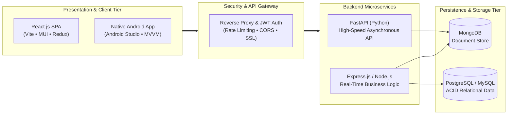

### Developer Profile

```json
{
  "name": "Vishnu Thangaraj",
  "title": "Software Development Engineer",
  "engineering_pillars": [
    "Modern Full-Stack Platforms (MERN & React/MUI)",
    "Native Android Ecosystems"
  ],
  "persistence_cache": ["MongoDB", "PostgreSQL", "MySQL"]
}
```

- **Modern Full-Stack Applications:** Engineering responsive web frontends in **React & MUI** backed by asynchronous, low-latency APIs built using the **MERN Stack** (MongoDB, Express.js, React, Node.js).
- **Containerization & Deployment:** Building containerized multi-stage deployments and managing environments with **Docker**.

---

### Technical Arsenal

<div align="center">
  <p><strong>Curated Technologies, Stacks, Runtimes & Glass Tooling</strong></p>
  <br>

  <!-- Frontend & UI Layer -->
  <p><code>CLIENT & INTERFACE LAYER</code></p>
  <picture>
    <source media="(prefers-color-scheme: dark)" srcset="https://skillicons.dev/icons?i=react,redux,tailwind,vite,html,css,js,ts,bootstrap&theme=dark&perline=9">
    <source media="(prefers-color-scheme: light)" srcset="https://skillicons.dev/icons?i=react,redux,tailwind,vite,html,css,js,ts,bootstrap&theme=light&perline=9">
    
  </picture>
  <br><br>

  <!-- Backend, Mobile & Systems -->
  <p><code>BACKEND, MOBILE & SYSTEMS ENGINE</code></p>
  <picture>
    <source media="(prefers-color-scheme: dark)" srcset="https://skillicons.dev/icons?i=nodejs,express,fastapi,py,androidstudio&theme=dark&perline=5">
    <source media="(prefers-color-scheme: light)" srcset="https://skillicons.dev/icons?i=nodejs,express,fastapi,py,androidstudio&theme=light&perline=5">
    
  </picture>
  <br><br>

  <!-- Databases, DevOps & Cloud Persistence -->
  <p><code>PERSISTENCE & INFRASTRUCTURE</code></p>
  <picture>
    <source media="(prefers-color-scheme: dark)" srcset="https://skillicons.dev/icons?i=mongodb,mysql,postgres,docker,git,github,postman,linux&theme=dark&perline=8">
    <source media="(prefers-color-scheme: light)" srcset="https://skillicons.dev/icons?i=mongodb,mysql,postgres,docker,git,github,postman,linux&theme=light&perline=8">
    
  </picture>
  <br><br>
</div>

<details>
<summary><b>View Comprehensive Matrix & Technology Specifications (Click to expand)</b></summary>
<br>

| Domain | Technologies & Stacks | Capabilities & Engineering Focus |
| :--- | :--- | :--- |
| **Frontend & Web** | `React` `MUI` `Redux Toolkit` `Vite` `Tailwind CSS` `JavaScript` `TypeScript` `HTML5` `CSS3` | Single Page Apps (SPA), State Management, Responsive Design, Component Lifecycle, Asynchronous UI, Liquid Glass Aesthetics |
| **Mobile & Android** | `Android Studio` `Material Design` `Room DB` `Firebase` | MVVM Architecture, Jetpack Components, Local SQLite/Room Caching, Retrofit REST Clients, Push Notifications, Background Workers |
| **Backend & APIs** | `Node.js` `Express.js` `FastAPI` `Python` | RESTful API Architecture, JWT/OAuth2 Authentication, Asynchronous Processing, Middleware Design, Microservices Ecosystem |
| **Databases & Storage** | `MongoDB` `MySQL` `PostgreSQL` | NoSQL Document Modeling, Relational Normalization & Indexing, Query Optimization, ACID Transactions |
| **DevOps & Tooling** | `Docker` `Git` `GitHub` `Postman` `Linux` `Gradle` | Containerization, Version Control & GitFlow, Automated API Testing, Unix CLI Automation, Dependency Management |

</details>

---

### System Architecture Workflow

<div align="center">
  <p><strong>End-to-End Enterprise & Liquid-Clean Data Flow</strong></p>
</div>


---

### Connect & Collaborate

<div align="center">

  <table width="100%">
    <tr>
      <td align="center" width="33%">
        <h4>Professional Network</h4>
        <p >Let's connect and discuss software engineering, full-stack architectures, and mobile innovations.</p>
        <br>
        <a href="https://linkedin.com/in/vishnuthangaraj">
          
        </a>
      </td>
      <td align="center" width="33%">
        <h4>Direct Inquiries</h4>
        <p>Have an interesting project, full-stack opening, or Android opportunity? Reach out directly.</p>
        <br>
        <a href="mailto:vishnuthangaraj@hotmail.com">
          
        </a>
      </td>
      <td align="center" width="33%">
        <h4>Open Source & Code</h4>
        <p>Explore my repositories, system designs, and ongoing engineering projects here on GitHub.</p>
        <br>
        <a href="https://github.com/VishnuThangaraj">
          
        </a>
      </td>
    </tr>
  </table>

  <br><br>

</div>
