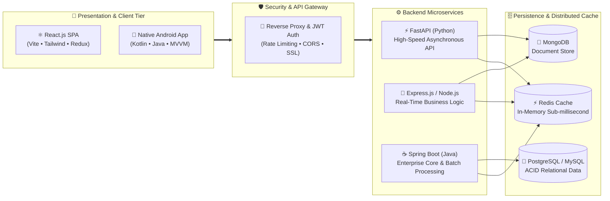

<div align="center">

  <!-- ==================== DYNAMIC LIQUID GLASS HERO HEADER ==================== -->
  <picture>
    <source media="(prefers-color-scheme: dark)" srcset="https://capsule-render.vercel.app/api?type=waving&color=gradient&custom_colors=38BDF8,6366F1,A855F7&height=120&section=header&text=VISHNU%20THANGARAJ&fontSize=42&fontColor=ffffff&fontAlignY=38&desc=Full-Stack%20%E2%80%A2%20Android%20%E2%80%A2%20Java%20Distributed%20Systems&descSize=16&descAlignY=62&descColor=e0f2fe">
    <source media="(prefers-color-scheme: light)" srcset="https://capsule-render.vercel.app/api?type=waving&color=gradient&custom_colors=0284C7,4F46E5,9333EA&height=120&section=header&text=VISHNU%20THANGARAJ&fontSize=42&fontColor=ffffff&fontAlignY=38&desc=Full-Stack%20%E2%80%A2%20Android%20%E2%80%A2%20Java%20Distributed%20Systems&descSize=16&descAlignY=62&descColor=ffffff">
    
  </picture>

  <br>

  <!-- ==================== DYNAMIC TYPING HUD ==================== -->
  <picture>
    <source media="(prefers-color-scheme: dark)" srcset="https://readme-typing-svg.demolab.com?font=Fira+Code&weight=600&size=21&duration=2800&pause=1000&color=38BDF8&center=true&vCenter=true&width=850&height=45&lines=%E2%9C%A8+Architecting+Scalable+Full-Stack+Web+Platforms+(MERN+%26+FARM);%F0%9F%93%B1+Crafting+High-Performance+Native+Android+Apps+(Kotlin+%26+Java);%E2%98%95+Engineering+Distributed+Enterprise+Backends+%26+Microservices;%F0%9F%92%8E+Building+Modern%2C+Liquid-Clean%2C+Ultra-Fast+Software">
    <source media="(prefers-color-scheme: light)" srcset="https://readme-typing-svg.demolab.com?font=Fira+Code&weight=600&size=21&duration=2800&pause=1000&color=0969DA&center=true&vCenter=true&width=850&height=45&lines=%E2%9C%A8+Architecting+Scalable+Full-Stack+Web+Platforms+(MERN+%26+FARM);%F0%9F%93%B1+Crafting+High-Performance+Native+Android+Apps+(Kotlin+%26+Java);%E2%98%95+Engineering+Distributed+Enterprise+Backends+%26+Microservices;%F0%9F%92%8E+Building+Modern%2C+Liquid-Clean%2C+Ultra-Fast+Software">
    
  </picture>

  <br>

  <!-- ==================== FROSTED STATUS PILLS ==================== -->
  <p>
    
    
    
    
  </p>

  <!-- ==================== FLOATING GLASS SOCIAL PILLS ==================== -->
  <p>
    <a href="https://linkedin.com/in/vishnuthangaraj">
      
    </a>
    &nbsp;
    <a href="mailto:vishnuthangaraj@hotmail.com">
      
    </a>
    &nbsp;
    <a href="https://github.com/VishnuThangaraj">
      
    </a>
  </p>

  <!-- ==================== SYNCHRONIZED GLASS HUD NAVIGATION ==================== -->
  <p>
    <code><a href="#-developer-profile">💎 Profile</a></code> &nbsp;✦&nbsp;
    <code><a href="#-technical-arsenal">🔮 Arsenal</a></code> &nbsp;✦&nbsp;
    <code><a href="#-system-architecture-workflow">📐 Architecture</a></code> &nbsp;✦&nbsp;
    <code><a href="#-liquid-telemetry--analytics">🌌 Analytics</a></code> &nbsp;✦&nbsp;
    <code><a href="#-connect--collaborate">✨ Connect</a></code>
  </p>

</div>

---

### 💎 Developer Profile

```json
{
  "name": "Vishnu Thangaraj",
  "title": "Software Development Engineer",
  "engineering_pillars": [
    "Modern Full-Stack Platforms (React, Node.js, FastAPI)",
    "Native Android Ecosystems (React Native)",
  ],
  "persistence_cache": ["MongoDB", "PostgreSQL", "MySQL"]
}
```

- 🌐 **Modern Full-Stack Applications:** Engineering responsive web frontends in **React & MUI** backed by asynchronous, low-latency APIs built using the **MERN Stack** (MongoDB, Express.js, React, Node.js).


- ⚡ **Containerization & Deployment:** Building containerized multi-stage deployments and managing environments with **Docker**.

---

### 🔮 Technical Arsenal

<div align="center">
  <p><strong>⚡ Curated Technologies, Stacks, Runtimes & Glass Tooling</strong></p>
  <br>

  <!-- Frontend & UI Layer -->
  <p><code>🌐 CLIENT & INTERFACE LAYER</code></p>
  <picture>
    <source media="(prefers-color-scheme: dark)" srcset="https://skillicons.dev/icons?i=react,redux,tailwind,vite,html,css,js,ts,bootstrap&theme=dark&perline=9">
    <source media="(prefers-color-scheme: light)" srcset="https://skillicons.dev/icons?i=react,redux,tailwind,vite,html,css,js,ts,bootstrap&theme=light&perline=9">
    
  </picture>
  <br><br>

  <!-- Backend, Mobile & Systems -->
  <p><code>⚙️ BACKEND, MOBILE & SYSTEMS ENGINE</code></p>
  <picture>
    <source media="(prefers-color-scheme: dark)" srcset="https://skillicons.dev/icons?i=nodejs,express,fastapi,py,java,androidstudio&theme=dark&perline=6">
    <source media="(prefers-color-scheme: light)" srcset="https://skillicons.dev/icons?i=nodejs,express,fastapi,py,java,androidstudio&theme=light&perline=6">
    
  </picture>
  <br><br>

  <!-- Databases, DevOps & Cloud Persistence -->
  <p><code>🗄️ PERSISTENCE, CACHE & INFRASTRUCTURE</code></p>
  <picture>
    <source media="(prefers-color-scheme: dark)" srcset="https://skillicons.dev/icons?i=mongodb,mysql,postgres,docker,git,github,postman,linux&theme=dark&perline=8">
    <source media="(prefers-color-scheme: light)" srcset="https://skillicons.dev/icons?i=mongodb,mysql,postgres,docker,git,github,postman,linux&theme=light&perline=8">
    
  </picture>
  <br><br>
</div>

<details>
<summary><b>🔍 View Comprehensive Matrix & Technology Specifications (Click to expand)</b></summary>
<br>

| Domain | Technologies & Stacks | Capabilities & Engineering Focus |
| :--- | :--- | :--- |
| **🌐 Frontend & Web** | `React` `MUI` `Redux Toolkit` `Vite` `Tailwind CSS` `JavaScript` `TypeScript` `HTML5` `CSS3` | Single Page Apps (SPA), State Management, Responsive Design, Component Lifecycle, Asynchronous UI, Liquid Glass Aesthetics |
| **📱 Mobile & Android** | `Android Studio` `Java` `Material Design` `Room DB` `Firebase` | MVVM Architecture, Jetpack Components, Local SQLite/Room Caching, Retrofit REST Clients, Push Notifications, Background Workers |
| **⚙️ Backend & APIs** | `Node.js` `Express.js` `FastAPI` `Python` `Core Java` | RESTful API Architecture, JWT/OAuth2 Authentication, Asynchronous Processing, Middleware Design, Microservices Ecosystem |
| **🗄️ Databases & Storage** | `MongoDB` `MySQL` `PostgreSQL` | NoSQL Document Modeling, Relational Normalization & Indexing, Query Optimization, ACID Transactions |
| **🛠️ DevOps & Tooling** | `Docker` `Git` `GitHub` `Postman` `Linux` `Gradle` | Containerization, Version Control & GitFlow, Automated API Testing, Unix CLI Automation, Dependency Management |

</details>

---

### 📐 System Architecture Workflow

<div align="center">
  <p><strong>🌐 End-to-End Enterprise & Liquid-Clean Data Flow</strong></p>
</div>



---


### 🌌 Telemetry & Analytics

<div align="center">

  <!-- ==================== LIQUID GLASS PROFILE SUMMARY HUD ==================== -->
  <picture>
    <source media="(prefers-color-scheme: dark)" srcset="https://github-profile-summary-cards.vercel.app/api/cards/profile-details?username=VishnuThangaraj&theme=tokyonight">
    <source media="(prefers-color-scheme: light)" srcset="https://github-profile-summary-cards.vercel.app/api/cards/profile-details?username=VishnuThangaraj&theme=default">
    
  </picture>

  <br><br>

  <!-- ==================== DUAL STATS & STREAK CARDS ==================== -->
  <table width="100%">
    <tr>
      <td width="50%" align="center">
        <a href="https://github.com/VishnuThangaraj">
          <picture>
            <source media="(prefers-color-scheme: dark)" srcset="https://github-stats-extended.vercel.app/api?username=VishnuThangaraj&show_icons=true&theme=tokyonight&hide_border=true&bg_color=0d1117&title_color=38bdf8&icon_color=6366f1&text_color=e2e8f0">
            <source media="(prefers-color-scheme: light)" srcset="https://github-stats-extended.vercel.app/api?username=VishnuThangaraj&show_icons=true&theme=default&hide_border=false&border_color=d0d7de&bg_color=ffffff&title_color=0969da&icon_color=0969da&text_color=1f2328">
            
          </picture>
        </a>
      </td>
      <td width="50%" align="center">
        <a href="https://github.com/VishnuThangaraj">
          <picture>
            <source media="(prefers-color-scheme: dark)" srcset="https://streak-stats.demolab.com/?user=VishnuThangaraj&theme=tokyonight&hide_border=true&background=0d1117&stroke=30363d&ring=38bdf8&fire=6366f1&currStreakLabel=38bdf8">
            <source media="(prefers-color-scheme: light)" srcset="https://streak-stats.demolab.com/?user=VishnuThangaraj&theme=light&hide_border=false&border=d0d7de&background=ffffff&stroke=d0d7de&ring=0969da&fire=f97316&currStreakLabel=0969da">
            
          </picture>
        </a>
      </td>
    </tr>
  </table>

  <br>

  <!-- ==================== LIQUID LANGUAGE SPECTRUM & ACTIVITY FLOW ==================== -->
  <table width="100%">
    <tr>
      <td width="48%" align="center">
        <a href="https://github.com/VishnuThangaraj">
          <picture>
            <source media="(prefers-color-scheme: dark)" srcset="https://github-stats-extended.vercel.app/api/top-langs/?username=VishnuThangaraj&layout=compact&theme=tokyonight&hide_border=true&bg_color=0d1117&title_color=38bdf8&text_color=e2e8f0&hide=jupyter%20notebook">
            <source media="(prefers-color-scheme: light)" srcset="https://github-stats-extended.vercel.app/api/top-langs/?username=VishnuThangaraj&layout=compact&theme=default&hide_border=false&border_color=d0d7de&bg_color=ffffff&title_color=0969da&text_color=1f2328&hide=jupyter%20notebook">
            
          </picture>
        </a>
      </td>
      <td width="52%" align="center">
        <a href="https://github.com/VishnuThangaraj">
          <picture>
            <source media="(prefers-color-scheme: dark)" srcset="https://github-readme-activity-graph.vercel.app/graph?username=VishnuThangaraj&theme=tokyo-night&bg_color=0d1117&color=38bdf8&line=6366f1&point=a855f7&area=true&hide_border=true">
            <source media="(prefers-color-scheme: light)" srcset="https://github-readme-activity-graph.vercel.app/graph?username=VishnuThangaraj&theme=github-light&bg_color=ffffff&color=0969da&line=4f46e5&point=9333ea&area=true&hide_border=false&border=d0d7de">
            
          </picture>
        </a>
      </td>
    </tr>
  </table>

</div>

---

### ✨ Connect & Collaborate

<div align="center">

  <table width="100%">
    <tr>
      <td align="center" width="33%">
        <h4>💼 Professional Network</h4>
        <p>Let's connect and discuss software engineering, distributed systems, and mobile innovations.</p>
        <br>
        <a href="https://linkedin.com/in/vishnuthangaraj">
          
        </a>
      </td>
      <td align="center" width="33%">
        <h4>📬 Direct Inquiries</h4>
        <p>Have an interesting project, full-stack opening, or Android opportunity? Reach out directly.</p>
        <br>
        <a href="mailto:vishnuthangaraj@hotmail.com">
          
        </a>
      </td>
      <td align="center" width="33%">
        <h4>🐙 Open Source & Code</h4>
        <p>Explore my repositories, system designs, and ongoing engineering projects here on GitHub.</p>
        <br>
        <a href="https://github.com/VishnuThangaraj">
          
        </a>
      </td>
    </tr>
  </table>

  <br><br>

  <!-- Visitor Count & Back to Top -->
  <p>
    
  </p>

  <p>
    <a href="#top">
      
    </a>
  </p>

  <picture>
    <source media="(prefers-color-scheme: dark)" srcset="https://capsule-render.vercel.app/api?type=waving&color=gradient&custom_colors=A855F7,6366F1,38BDF8&height=80&section=footer&reversal=false">
    <source media="(prefers-color-scheme: light)" srcset="https://capsule-render.vercel.app/api?type=waving&color=gradient&custom_colors=9333EA,4F46E5,0284C7&height=80&section=footer&reversal=false">
    
  </picture>

</div>
