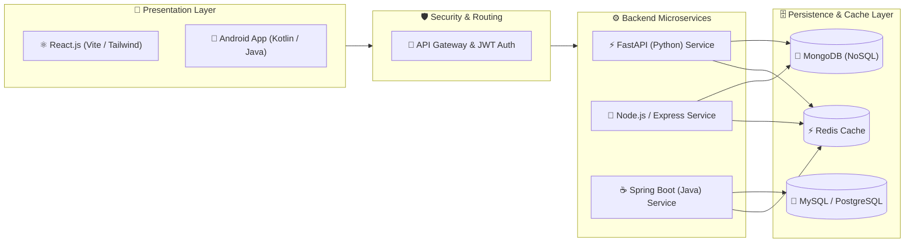

  <!-- ==================== HEADER BANNER ==================== -->
  

   

  <!-- ==================== DYNAMIC TYPING ANIMATION ==================== -->
  

    

  <!-- ==================== STATUS & BADGES ==================== -->
  

    
    
    
  

  <!-- ==================== SOCIAL / CONNECT PILLS ==================== -->
  

    
    &nbsp;
    
    &nbsp;
    
  

  <!-- ==================== QUICK JUMP NAVIGATION ==================== -->
  

    <code><a href="#-developer-profile">🚀 Profile</a></code> •
    <code><a href="#-core-specialization-pillars">🎯 Pillars</a></code> •
    <code><a href="#-featured-projects--repositories">💼 Projects</a></code> •
    <code><a href="#-technical-arsenal">🛠️ Arsenal</a></code> •
    <code><a href="#-system-architecture-workflow">📐 Architecture</a></code> •
    <code><a href="#-engineering-practices--design-patterns">🏗️ Best Practices</a></code> •
    <code><a href="#-algorithmic-mastery--problem-solving">🧠 Problem Solving</a></code> •
    <code><a href="#-workstation--development-environment">💻 Workstation</a></code> •
    <code><a href="#-github-analytics--insights">📊 Analytics</a></code> •
    <code><a href="#-connect--collaborate">📫 Connect</a></code>
  

---

### 🚀 Developer Profile

<table>
  <tr>
    <td width="64%" valign="top">
      <pre>
<b>vishnu@workstation:~$</b> whoami
&gt; Vishnu Thangaraj — Software Engineer & Full-Stack / Mobile Developer

<b>vishnu@workstation:~$</b> cat engineering_profile.json
{
  "name": "Vishnu Thangaraj",
  "roles": ["Full-Stack Engineer", "Android Developer", "Java Backend Developer"],
  "core_frameworks": {
    "mern": ["MongoDB", "Express.js", "React.js", "Node.js"],
    "farm": ["FastAPI", "React.js", "MongoDB", "Python"],
    "mobile": ["Native Android", "Java", "Kotlin", "Android Studio"],
    "backend": ["Java (Spring Boot)", "RESTful APIs", "Microservices"]
  },
  "databases": ["MongoDB", "MySQL", "Redis"],
  "current_focus": "High-concurrency systems, scalable architecture & clean code"
}
      </pre>
      <ul>
        <li>🌐 <strong>Web Engineering:</strong> Architecting responsive single-page applications with <strong>React</strong>, backed by high-throughput REST APIs built with <strong>Express.js</strong> and <strong>FastAPI</strong>.</li>
        <li>📱 <strong>Mobile Engineering:</strong> Developing native Android apps using <strong>Java</strong>, <strong>Kotlin</strong>, MVVM architecture, and Jetpack components.</li>
        <li>☕ <strong>Java & Systems:</strong> Designing robust object-oriented systems, enterprise microservices, and database interaction layers with <strong>Spring Boot</strong> and <strong>JPA/Hibernate</strong>.</li>
        <li>⚡ <strong>Performance & Scalability:</strong> Optimizing API latency, implementing Redis caching layers, and designing clean NoSQL/SQL schemas.</li>
      </ul>
    </td>
    <td width="36%" align="center" valign="middle">
      
    </td>
  </tr>
</table>

---

### 🎯 Core Specialization Pillars

<table width="100%">
  <tr>
    <td width="50%" valign="top">
      

        <h3>⚛️ MERN Stack Ecosystem</h3>
        
<em>Full-Stack JavaScript/TypeScript Architecture</em>

      

      <ul>
        <li><strong>Frontend:</strong> React 18+, Redux Toolkit, Vite, Tailwind CSS, Component Modularization</li>
        <li><strong>Server Runtime:</strong> Node.js event-driven architecture, Express.js routing & middlewares</li>
        <li><strong>Database Layer:</strong> MongoDB, Mongoose ODM, Aggregation pipelines, Indexing</li>
        <li><strong>Security & Realtime:</strong> JWT authentication, bcrypt hashing, WebSockets</li>
      </ul>
      

        
        
        
        
        
      

    </td>
    <td width="50%" valign="top">
      

        <h3>⚡ FARM Stack Architecture</h3>
        
<em>High-Performance Asynchronous Python + Modern React</em>

      

      <ul>
        <li><strong>API Framework:</strong> FastAPI asynchronous ASGI server, Pydantic type validation</li>
        <li><strong>Client Integration:</strong> React hooks, Axios/React Query, real-time state synchronization</li>
        <li><strong>Async Database:</strong> Motor / Beanie ODM for non-blocking MongoDB operations</li>
        <li><strong>API Documentation:</strong> Interactive OpenAPI / Swagger auto-generated docs</li>
      </ul>
      

        
        
        
        
        
      

    </td>
  </tr>
  <tr>
    <td width="50%" valign="top">
      

        <h3>📱 Native Android Engineering</h3>
        
<em>Robust Mobile Client Applications</em>

      

      <ul>
        <li><strong>Languages & IDE:</strong> Java for Android, Kotlin, Android Studio Arctic/Koala+</li>
        <li><strong>UI & Design:</strong> XML Layouts, Material Design 3, View Binding, ConstraintLayout</li>
        <li><strong>Architecture:</strong> MVVM (Model-View-ViewModel), LiveData, ViewModel, Lifecycle</li>
        <li><strong>Data & Services:</strong> Room Database (SQLite), Retrofit2 networking, Firebase Auth</li>
      </ul>
      

        
        
        
        
        
      

    </td>
    <td width="50%" valign="top">
      

        <h3>☕ Enterprise Java & Backend</h3>
        
<em>Object-Oriented Design & Microservice Systems</em>

      

      <ul>
        <li><strong>Core Foundations:</strong> Java SE 17/21, OOP Principles, Collections Framework, Multithreading</li>
        <li><strong>Frameworks:</strong> Spring Boot, Spring MVC, Spring Data JPA, Hibernate ORM</li>
        <li><strong>API Design:</strong> RESTful API principles, Exception handling, DTO mapping, Validation</li>
        <li><strong>Build Systems:</strong> Maven, Gradle, Dependency injection & Clean Architecture</li>
      </ul>
      

        
        
        
        
        
      

    </td>
  </tr>
</table>

---

### 💼 Featured Projects & Repositories

<table width="100%">
  <tr>
    <td width="50%" valign="top">
      

        <h4>📱 <a href="https://github.com/VishnuThangaraj/Streakly">Streakly — Offline Habit & Streak Tracker</a></h4>
      

      

        A minimal, privacy-centric, ad-free habit tracker engineered for offline-first mobile performance. Features local persistent state, streak mechanics, and smooth UI transitions.
      

      

        
        
        
      

      

        
      

    </td>
    <td width="50%" valign="top">
      

        <h4>☕ <a href="https://github.com/VishnuThangaraj/Problem-Solving-Java">Problem-Solving Java Engine</a></h4>
      

      

        Comprehensive repository of optimized algorithms, data structures, dynamic programming solutions, and object-oriented system design challenges implemented in clean Java.
      

      

        
        
        
      

      

        
      

    </td>
  </tr>
  <tr>
    <td width="50%" valign="top">
      

        <h4>⚡ <a href="https://github.com/VishnuThangaraj/Leetcode-Solutions">LeetCode Solutions & Algorithmic Patterns</a></h4>
      

      

        Curated algorithmic solutions in TypeScript and JavaScript covering Two Pointers, Sliding Window, Graph BFS/DFS, Trees, and DP with optimal time and space complexity.
      

      

        
        
        
      

      

        
      

    </td>
    <td width="50%" valign="top">
      

        <h4>🛡️ <a href="https://github.com/VishnuThangaraj/RegEntropy-Compliance_Intelligence">Compliance Intelligence Service</a></h4>
      

      

        High-throughput backend service built with FastAPI and MongoDB for automated policy validation, structured rule enforcement, and real-time claim compliance validation.
      

      

        
        
        
      

      

        
      

    </td>
  </tr>
</table>

---

### 🛠️ Technical Arsenal

   
  
    
  
    
  
    

<b>🔍 View Comprehensive Matrix & Technology Specifications</b>

 

<table width="100%">
  <thead>
    <tr>
      <th width="25%">Category</th>
      <th width="35%">Technologies & Frameworks</th>
      <th width="40%">Capabilities & Key Concepts</th>
    </tr>
  </thead>
  <tbody>
    <tr>
      <td><strong>🌐 Frontend & Web</strong></td>
      <td>
        
        
        
        
        
        
        
        
      </td>
      <td>Single Page Apps (SPA), State Management, Responsive Design, Component Lifecycle, Asynchronous UI</td>
    </tr>
    <tr>
      <td><strong>📱 Mobile & Android</strong></td>
      <td>
        
        
        
        
        
        
      </td>
      <td>MVVM Architecture, Jetpack Components, Local SQLite Storage, Retrofit REST Clients, Push Notifications</td>
    </tr>
    <tr>
      <td><strong>⚙️ Backend & APIs</strong></td>
      <td>
        
        
        
        
        
        
      </td>
      <td>RESTful API Architecture, JWT Authentication, Asynchronous Processing, Middleware Design, Microservices</td>
    </tr>
    <tr>
      <td><strong>🗄️ Databases & Storage</strong></td>
      <td>
        
        
        
        
      </td>
      <td>NoSQL Document Modeling, Relational Schema Normalization, Query Indexing, In-Memory Caching, Transactions</td>
    </tr>
    <tr>
      <td><strong>🛠️ DevOps & Tooling</strong></td>
      <td>
        
        
        
        
        
        
      </td>
      <td>Containerization, Version Control, API Testing & Documentation, Unix CLI Automation, Dependency Management</td>
    </tr>
  </tbody>
</table>

---

### 📐 System Architecture Workflow

---

### 🏗️ Engineering Practices & Design Patterns

<table width="100%">
  <tr>
    <td width="33%" valign="top">
      <h4>🏛️ Clean Architecture</h4>
      <ul>
        <li><strong>SOLID Principles:</strong> Separation of concerns, Dependency Inversion, and Interface Segregation across Java and TypeScript.</li>
        <li><strong>Layered Design:</strong> Controller ➔ Service ➔ Repository pattern for decoupled maintainability.</li>
        <li><strong>DTOs & Validation:</strong> Strict payload typing with Pydantic (FastAPI), Zod (TypeScript), and Jakarta Validation (Spring Boot).</li>
      </ul>
    </td>
    <td width="33%" valign="top">
      <h4>⚡ Concurrency & Performance</h4>
      <ul>
        <li><strong>Async I/O:</strong> Non-blocking event loop in Node.js and async coroutines in FastAPI (ASGI).</li>
        <li><strong>Java Multithreading:</strong> ExecutorService, thread pools, and concurrent collections for high throughput.</li>
        <li><strong>Caching Patterns:</strong> Cache-aside and write-through caching using Redis with TTL expiration.</li>
      </ul>
    </td>
    <td width="33%" valign="top">
      <h4>🔒 Security & Reliability</h4>
      <ul>
        <li><strong>Auth Pipelines:</strong> Stateless JWT tokens with refresh token rotation and bcrypt password hashing.</li>
        <li><strong>Resilience:</strong> Exponential backoff retry policies, rate limiting, and global exception filters.</li>
        <li><strong>Clean DB Queries:</strong> Indexed MongoDB queries, SQL prepared statements to prevent injection.</li>
      </ul>
    </td>
  </tr>
</table>

---

### 🧠 Algorithmic Mastery & Problem Solving

<table width="100%">
  <tr>
    <td width="60%" valign="top">
      

        I treat algorithms and data structure optimization as foundational craft. Regularly practicing algorithmic challenges, optimizing space/time complexity, and designing data pipelines with efficiency in mind.
      

      <ul>
        <li><strong>Primary Languages:</strong> Java SE, TypeScript, Python 3</li>
        <li><strong>Core Problem Patterns:</strong> Two Pointers, Sliding Window, Fast & Slow Pointers, BFS/DFS Traversal, Dynamic Programming, Binary Search, Monotonic Stack</li>
        <li><strong>Data Structures:</strong> Self-Balancing Trees, Hash Tables, Heaps/Priority Queues, Graphs, Tries, Disjoint Set (Union-Find)</li>
      </ul>
    </td>
    <td width="40%" align="center" valign="middle">
      

        
          
        
      

    </td>
  </tr>
</table>

---

### 💻 Workstation & Development Environment

<table width="100%">
  <tr>
    <td align="center" width="20%">
      <strong>Operating System</strong> 
      <code>Windows / Linux (Ubuntu)</code>
    </td>
    <td align="center" width="20%">
      <strong>Primary IDEs</strong> 
      <code>VS Code / Android Studio / IntelliJ</code>
    </td>
    <td align="center" width="20%">
      <strong>Shell & Terminal</strong> 
      <code>PowerShell / Zsh / Bash</code>
    </td>
    <td align="center" width="20%">
      <strong>Runtimes & SDKs</strong> 
      <code>JDK 17/21 • Node.js 20+ • Python 3.11+</code>
    </td>
    <td align="center" width="20%">
      <strong>API & Build Tools</strong> 
      <code>Postman • Docker • Gradle • Maven</code>
    </td>
  </tr>
</table>

---

### 📊 GitHub Analytics & Insights

  <table width="100%">
    <tr>
      <td width="50%" align="center">
        
      </td>
      <td width="50%" align="center">
        
      </td>
    </tr>
  </table>

 

  <table width="100%">
    <tr>
      <td width="48%" align="center">
        
      </td>
      <td width="52%" align="center">
        
      </td>
    </tr>
  </table>

---

### 📫 Connect & Collaborate

  <table>
    <tr>
      <td align="center" width="33%">
        <h4>💼 Professional Network</h4>
        
Let's connect and discuss software architecture, web development, and mobile solutions.

        
      </td>
      <td align="center" width="33%">
        <h4>📬 Direct Inquiries</h4>
        
Have an interesting project, full-stack opening, or Android opportunity? Drop me a message.

        
      </td>
      <td align="center" width="33%">
        <h4>🐙 Open Source & Code</h4>
        
Explore my repositories, code architectures, and ongoing projects here on GitHub.

        
      </td>
    </tr>
  </table>

   

  
<strong>Visitor Count</strong>

  

    

  <!-- ==================== FOOTER BANNER ==================== -->
  

